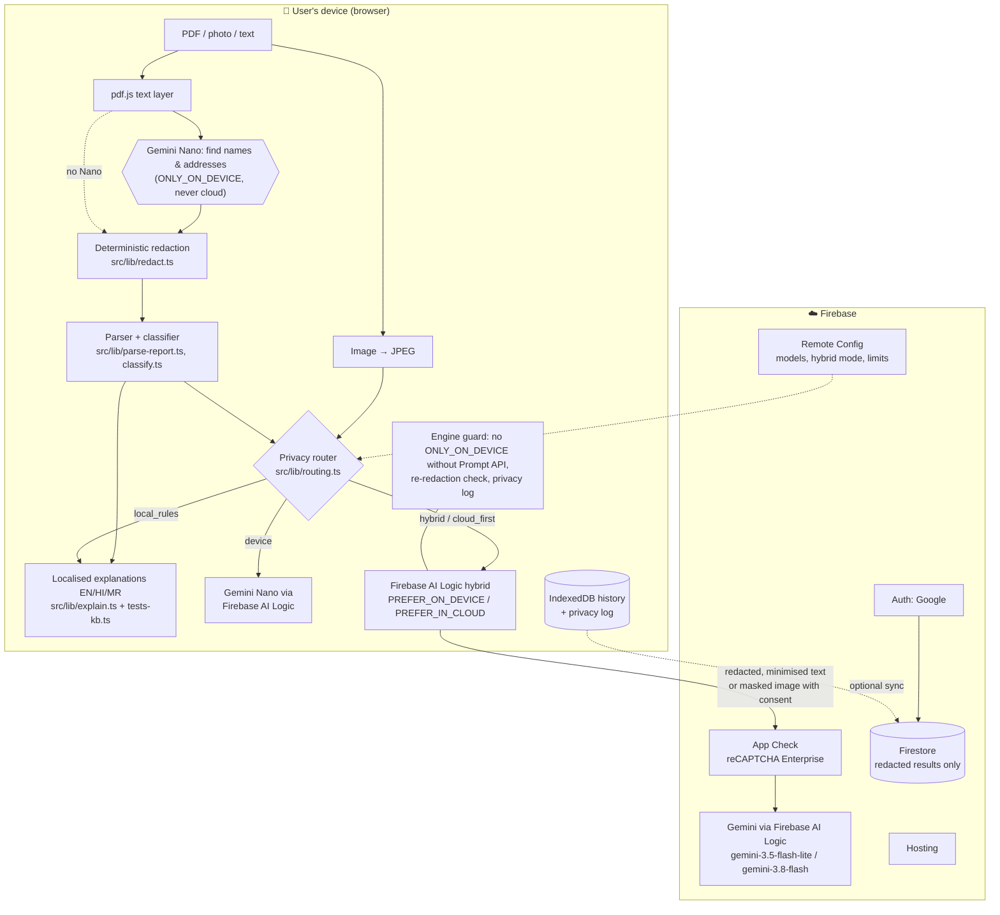

# LabLens: a privacy-first lab report and prescription explainer

**Photograph a lab report or prescription and understand it in English, हिन्दी or मराठी. Your name, phone number and IDs are removed on your device before any AI sees the report.**

LabLens is a hybrid-AI web app (installable PWA) built with **Firebase AI Logic**. Gemini Nano runs inside Chrome, on the device, and Gemini in the cloud is the fallback. It was built for the Firebase *#BuildHybridAI 2026* hackathon (Web / Chrome).

> ⚕️ LabLens is an assistive tool, not a diagnosis. It explains what a report says and helps you prepare questions for your doctor.

**Live app:** _added after the first deployment, see [SUBMISSION.md](SUBMISSION.md)_ · **Demo video:** _see SUBMISSION.md_ · **Licence:** [Apache-2.0](LICENSE)

---

## The problem

In India, people collect their own lab reports, often on WhatsApp or as a printout, days before they see a doctor. The report is a dense table of abbreviations (TLC, SGPT, HbA1c), numbers and reference ranges. It is usually in English, while hundreds of millions of people prefer Hindi, Marathi or another Indian language. Prescriptions add shorthand like `1-0-1`, `BD` and `SOS`.

People increasingly paste these reports into general chatbots. That means uploading a document that carries the patient's **name, phone number, address, Aadhaar/ABHA or hospital ID** together with their **health data**, which is exactly what India's DPDP Act 2023 treats as personal data.

## Why hybrid AI is the right design

| Need | Why on-device | Why cloud |
|---|---|---|
| Removing identifiers | The raw report must never leave the phone or laptop. Gemini Nano finds names and addresses on the device | Never used for this |
| Explaining values | Free, instant, and works **offline** (clinic waiting rooms, patchy 4G) | When the device has no Nano (most phones today) |
| Hindi/Marathi narrative | When Nano supports the language (LabLens probes for this via Remote Config) | Nano in Chrome writes en/ja/es/de/fr only, so the cloud writes the narrative from **redacted, minimised** data |
| Hard scans, long reports, doctor checklist | Simple photos are read by Nano (multimodal) | Gemini's bigger model, only with consent (images) or on redacted text |

The deterministic core is just as important. **The AI never decides whether a value is low or high.** Tested code compares each value with the report's own range. It handles units such as lakh/cumm and 10³/µL and flags critical values. The models explain those flags; they never invent them.

## What it does

- 📄 **Upload a PDF, a photo or text, use the camera, or paste.** Text PDFs are read locally with pdf.js. Photos and scans are read by **Gemini Nano on the device**, or, with explicit consent, by Gemini in the cloud **after you black out personal details** on a masking canvas.
- 🛡️ **On-device redaction.** Nano proposes the names and addresses it finds, and deterministic rules mask Indian phone numbers, Aadhaar, ABHA, PAN, email, UHID/lab IDs, honorific names (Mr/Smt/श्री/सौ.) and labelled fields in all three languages.
- 🚦 **Value-by-value explanations.** Each value is flagged normal, borderline, low, high or critical, with colour, an icon and text, plus a range bar. Each comes with a plain-language meaning and a *"Talk to your doctor about…"* line, all in three languages and all **offline**, because they come from a curated, tested knowledge base of 33 common Indian lab tests.
- 🚨 **An urgent banner** for critical values (e.g. potassium 6.8) advises seeing a doctor today or calling 108.
- 💊 **Prescription decoding.** `1-0-1`, OD/BD/TDS/HS/SOS, before or after food, and duration are turned into a plain schedule.
- 💬 **Follow-up questions** (personal details in the question are masked too), a **doctor-question checklist**, and a **deeper cloud analysis** of patterns across the whole report.
- 🏷️ **A "Processed on device / in cloud / LabLens rules" badge** on every answer, and a **privacy log** that shows exactly what was sent for anything that ran in the cloud.
- 🔒 **An "On-device only" switch.** Nothing leaves the device, and LabLens still explains the report with its rules.
- 📈 **History and trends** are saved locally in IndexedDB. A trend chart covers repeated tests (e.g. HbA1c 7.6 → 7.0 → 6.4). **Google sign-in sync to Firestore** is optional and syncs redacted structured results only.
- 📱 **An installable, offline-capable PWA**, responsive, with Lighthouse Accessibility 100 and 0 axe WCAG 2.1 AA violations, keyboard and screen-reader friendly.

## Architecture



### On-device vs cloud split

| Task | Route chosen by `decideRoute()` | InferenceMode | Data that may leave the device |
|---|---|---|---|
| Find personal details | Nano only, or rules when there's no Nano | `ONLY_ON_DEVICE` | **Never anything** |
| Read a photo/scan | Nano. Cloud only with **per-image consent + masking** | `ONLY_ON_DEVICE`, or `PREFER_ON_DEVICE` after consent | The masked image, after consent |
| Structure messy text | Nano, falling back to the cloud | `PREFER_ON_DEVICE` (Remote Config can switch it) | Redacted text |
| Summary (EN) / answers | Nano, falling back to the cloud | `PREFER_ON_DEVICE` | Test names, values, units, ranges, flags, age/sex |
| Summary (HI/MR) | Cloud (Nano has no hi/mr), or English Nano when offline or in on-device-only mode | `ONLY_IN_CLOUD` / `ONLY_ON_DEVICE` | Same minimised findings |
| Doctor checklist | Cloud first, Nano offline, rules last | `PREFER_IN_CLOUD` | Minimised findings |
| Deeper analysis | Cloud only | `ONLY_IN_CLOUD` | Redacted full text |
| Flags, ranges, explanations, urgent banner, prescriptions | **No model**: tested rules | — | Nothing |

The model names, the hybrid mode, the on-device size budget, cloud image reading on/off and the extra Nano languages are all **Remote Config** parameters: `cloud_model`, `cloud_model_lite`, `hybrid_mode`, `max_device_chars`, `cloud_image_enabled` and `nano_extra_langs`.

## Privacy design

1. **Redact first, on the device.** Raw text only ever reaches Gemini Nano (`ONLY_ON_DEVICE`) or the regex engine.
2. **Data minimisation.** Summaries, answers and checklists send only *structured findings*, never the report text (`findingsPayload()`).
3. **A last-line check.** Before any cloud-capable call, `engine.ts` runs the redactor again on the prompt and masks anything that still looks like an identifier.
4. **A guard against an SDK edge case.** If `window.LanguageModel` is missing, the Firebase AI Logic web SDK sends even `ONLY_ON_DEVICE` requests to the cloud (we read this in `callCloudOrDevice`). LabLens refuses the call instead of letting it fall back silently.
5. **Images need consent.** A raw photo goes to the cloud only after the user covers personal details and ticks consent. Declining sends nothing (e2e-tested).
6. **Transparency.** A source badge appears on every answer. The privacy log lists every AI step and the exact payload of every cloud call.
7. **Storage.** The redacted text stays in IndexedDB on the device. Firestore receives only redacted structured results, under owner-only security rules (`firestore.rules`).
8. **App Check** (reCAPTCHA Enterprise) protects the Gemini API. API keys are not secrets, but they live in env vars and are restricted by HTTP referrer.

## Setup (≤ 5 commands)

```bash
git clone https://github.com/madhavzanwar/firebase-hc.git && cd firebase-hc
```
```bash
npm ci
```
```bash
cp .env.example .env.local   # then paste your Firebase web config + reCAPTCHA Enterprise site key
```
```bash
npm run dev                  # http://localhost:5173
```

Without a `.env.local`, LabLens still runs: everything deterministic works (redaction, flags, explanations in three languages, prescriptions, history). Firebase is needed for any model call, because all inference goes through Firebase AI Logic.

**Firebase project setup** (one time, in the Firebase console):

1. Create a project and add a **Web app**. Copy its config into `.env.local`.
2. Go to **AI Services → AI Logic → Get started** and choose the **Gemini Developer API**. The guided setup enforces App Check.
3. Go to **Security → App Check → Apps**, register the web app with **reCAPTCHA Enterprise**, and put the site key in `VITE_RECAPTCHA_ENTERPRISE_KEY`. For localhost, set `VITE_APPCHECK_DEBUG=true` and register the debug token printed in the console. Never add `localhost` to the reCAPTCHA domains.
4. Optional: **Authentication → Google**, **Firestore** (`firebase deploy --only firestore:rules`), and **Remote Config** with the parameters above.
5. Deploy with `npm run build && npx firebase-tools deploy --only hosting,firestore:rules`, or push to GitHub with the repository variables and the `FIREBASE_SERVICE_ACCOUNT` secret set (see `.github/workflows/ci-deploy.yml`).

## Chrome requirements for on-device AI (Gemini Nano)

- **Desktop Chrome 139+** on Windows 10/11, macOS 13+, Linux or ChromeOS (Chromebook Plus).
- **22 GB free disk space**, and either a GPU with more than 4 GB VRAM or a CPU with 16 GB RAM and 4+ cores.
- Set `chrome://flags/#prompt-api-for-gemini-nano-multimodal-input` to **Enabled** (this enables image input). If Nano still shows as unavailable, also set `chrome://flags/#optimization-guide-on-device-model` to **Enabled BypassPerfRequirement**. Then restart Chrome.
- In LabLens, click **"Enable on-device AI"**. This calls `initializeDeviceModel()` on a user gesture, and the first download takes a few minutes. The status chip shows *Gemini Nano ready on this device* when it's done.
- To check by hand, run `await LanguageModel.availability()` in DevTools. It should return `"available"`.

## Quality

Lint, strict typecheck, **158 unit tests**, **9 Playwright e2e tests** (on-device path, cloud fallback, consent, on-device-only, offline, trend, and axe WCAG 2.1 AA scans) and Lighthouse (Accessibility / Best Practices / SEO 100). Details are in [docs/QA.md](docs/QA.md). To run everything:

```bash
npm run qa && npm run lighthouse
```

## Limitations

- Gemini Nano in Chrome does not write Hindi or Marathi yet, so narrative text in those languages needs the cloud. Value explanations are always local.
- On-device inference is desktop-Chrome only. On phones, LabLens uses the cloud fallback, or rules in on-device-only mode.
- Default reference ranges are typical adult ranges and are used only when a report prints none. Children, pregnancy and lab methods can differ.
- Reading handwriting and blurry photos is unreliable, so always compare the extracted values with the paper report.
- Redaction is best-effort. It is layered (Nano, then rules, then a final check), but no automated redaction is perfect, which is why images additionally need user masking and consent.
- LabLens gives general educational information and is not a medical device.

## Project structure

```
src/lib/        pure, tested core: redact, ranges, classify, match, parse-report, rx, explain, routing, tests-kb
src/ai/         Firebase init + App Check, Remote Config, Nano probe, hybrid engine, prompts/schemas
src/app/        pipeline, input (pdf.js/images), state, router, samples
src/pages/      Home, Report, History (trend + sync), Privacy log, Help
fixtures/       11 synthetic EN/HI/MR documents + expected results
e2e/            Playwright tests with a fake Prompt API and a mocked cloud
docs/           RESEARCH.md, QA.md, DEMO_SCRIPT.md
```

## Credits

LabLens builds on open-source software and public samples. The full list, with licences, is in [CREDITS.md](CREDITS.md). In short: Firebase JS SDK, React, Vite, Tailwind CSS, pdf.js, i18next, Zod, Recharts, idb, Lucide, Workbox/vite-plugin-pwa, Fontsource (Inter, Noto Sans Devanagari), Vitest, Playwright, axe-core and Lighthouse. The Firebase AI Logic usage patterns follow the official docs and the FriendlyMeals-web sample.

## Licence

[Apache License 2.0](LICENSE). All sample reports are synthetic and describe fictional people.
